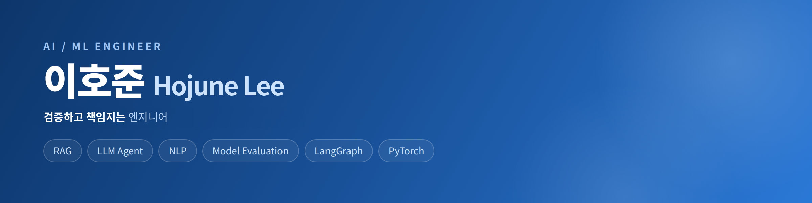
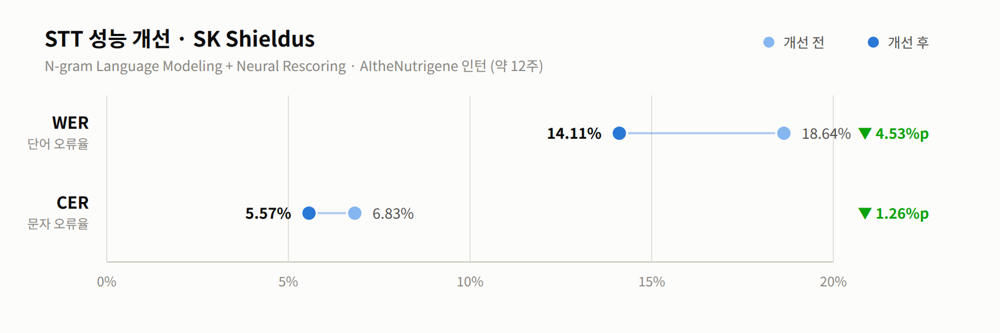
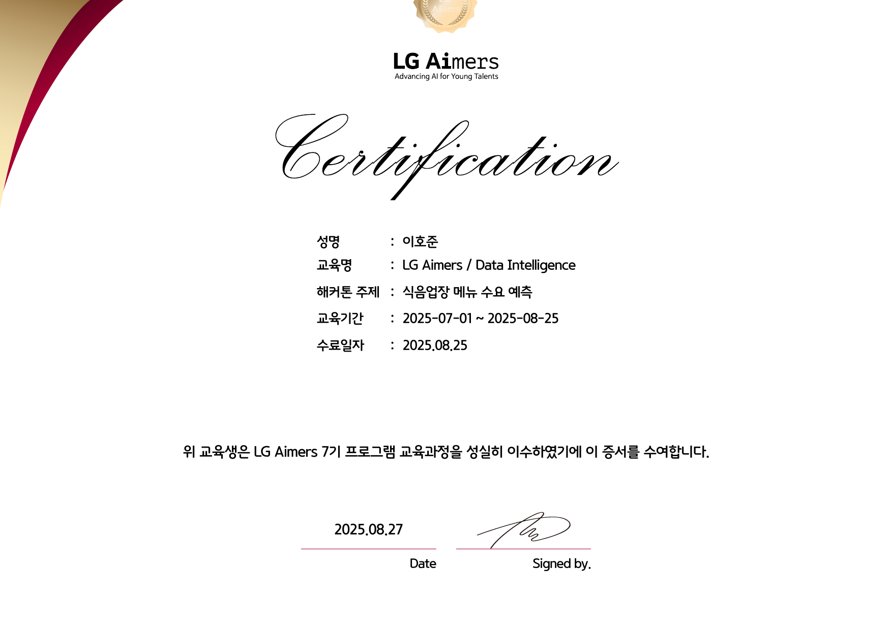

  

  
  
  

---

## 👋 About Me

음성 인식(STT)과 음성 합성(TTS)에서 시작해, 지금은 **RAG와 LLM 에이전트**를 만들고 있습니다.

직관이 아닌 정량적 지표를 바탕으로, 실용적이고 통제 가능한 LLM 에이전트를 구축합니다.

| | |
|---|---|
| 🎓 | **숭실대학교 소프트웨어학부** (2020.03 ~ 2026.02) |
| 🚀 | **카카오테크 부트캠프 AI 실무개발 4기** (2026.05 ~ ) |
| 🎖️ | 해병대 1263기 병장 만기전역 (2020.10 ~ 2022.04) |
| 🔬 | RAG Architecture · Agent Systems · LLM Fine-tuning · Evaluation |

---

## 🚀 Projects

| 프로젝트 | 서비스 설명 | 레포 |
|---|---|---|
| 📈 **맴매** `진행 중` | 카페·소규모 음식점의 POS 매출로 다음 달 일별 매출을 예측하고, 그 지표를 근거로 운영 솔루션을 제안하는 서비스 | [100-hours-a-week/KTB4-7th-AI](https://github.com/100-hours-a-week/KTB4-7th-AI) |
| 🛂 **Settle Agent** | 국내 체류 외국인의 금융·행정 정착을 돕는 AI 에이전트. 체류자격별로 할 수 있는 일을 안내하고 법령 근거 답변과 서식 PDF 작성을 지원 | [settle-AGENT/settle-agent](https://github.com/settle-AGENT/settle-agent) |
| ⚖️ **법대로** | 법조문·대법원 판례·생활법령을 근거로 답하고 조문 번호와 사건번호를 인용하는 생활법률 RAG 챗봇 | [HojuneLee0106/online_law](https://github.com/HojuneLee0106/online_law) |

---

## 🏆 AI 성능 개선 대회 — 최우수상

> **카카오 약관 QA 시스템** · 13팀 ·  **88.889 / 100**
> 검색 MRR `1.0000` · 키팩트 F1 `0.6721` · LLM 판정 `97.450`
> 공개 10문항 검색 recall **12/12** · precision **12/12**

카카오 약관 4종에서 질문에 해당하는 조항을 찾아 **답변과 근거 조항을 함께** 반환하는 RAG입니다.
Google Colab T4 한 대, 외부 API 없이 동작합니다. → [저장소 보기](https://github.com/HojuneLee0106/Performance_Improvement_Contest)

---

## 💼 Experience

### AItheNutrigene · AI/ML 인턴 2024.12 ~ 2025.02

**SK Shieldus STT 성능 개선 프로젝트** (약 12주) — `Python` `NVIDIA NeMo` `KenLM`

<picture>
  <source media="(prefers-color-scheme: dark)" srcset="assets/stt-improvement-dark.png">
  
</picture>

N-gram Language Modeling으로 도메인 어휘를 반영하고, Neural Rescoring으로 후보 문장을 다시 정렬해 인식 오류를 줄였습니다.

---

## 📊 GitHub Stats

  

---

## 🏅 Activities & Certification

### 🎓 LG Aimers 7기 · Data Intelligence 2025.07.01 ~ 2025.08.25 수료

수료증 보기

 

 

### 🏈 숭실대학교 크루세이더스 (중앙 미식축구부)

- 회장 2023.10 ~ 2024.11
- 디펜스 캡틴 2022.06 ~ 2025.12
- 2025 서울 대학 미식축구 최강자전 **준우승**

 

### 📜 Certification

- OPIc **IH** 2026.03
- 정보처리기사 2026.09 취득
- ADSP 2026.08 취득
---
