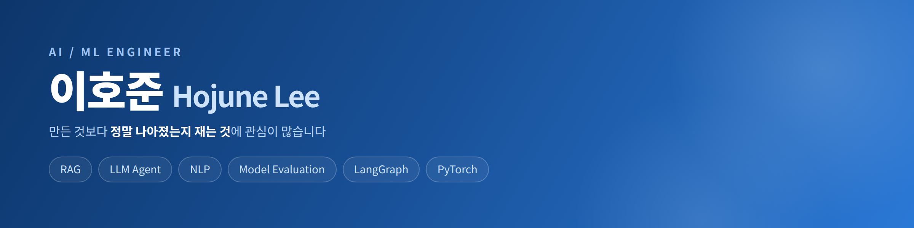
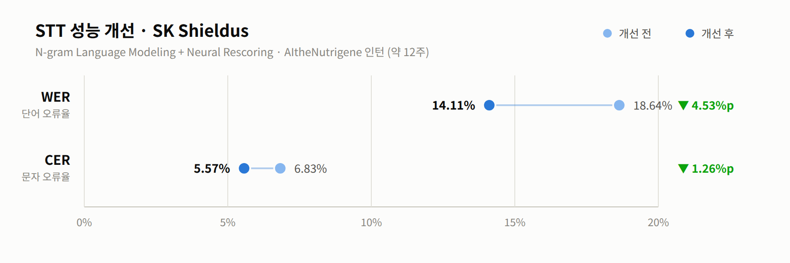
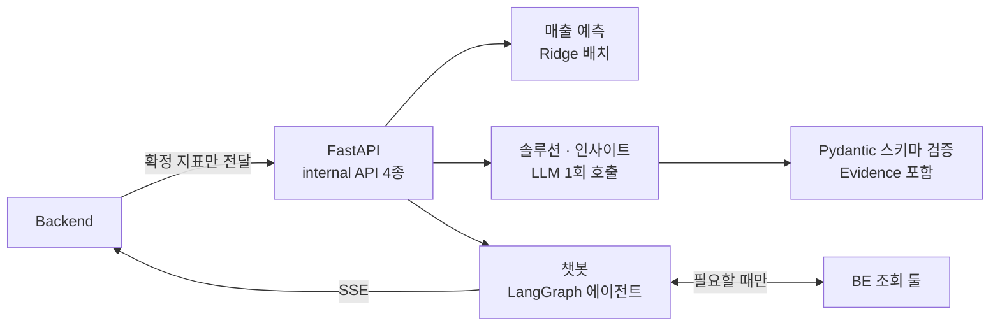
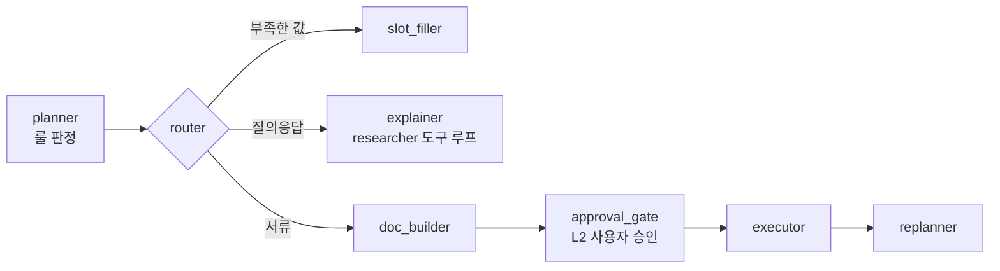
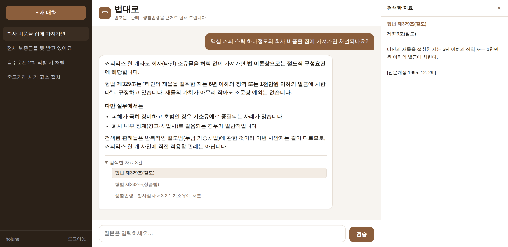
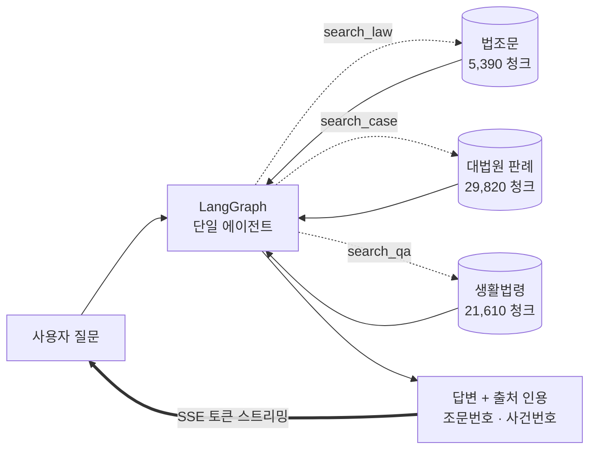
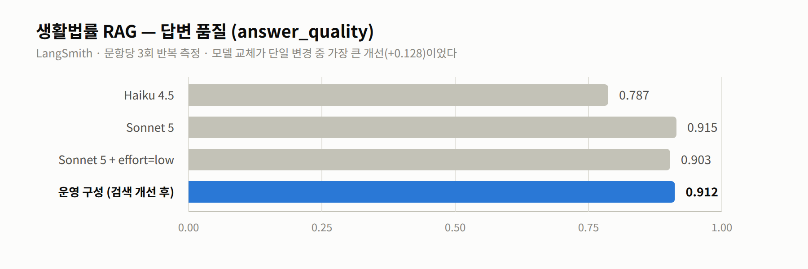
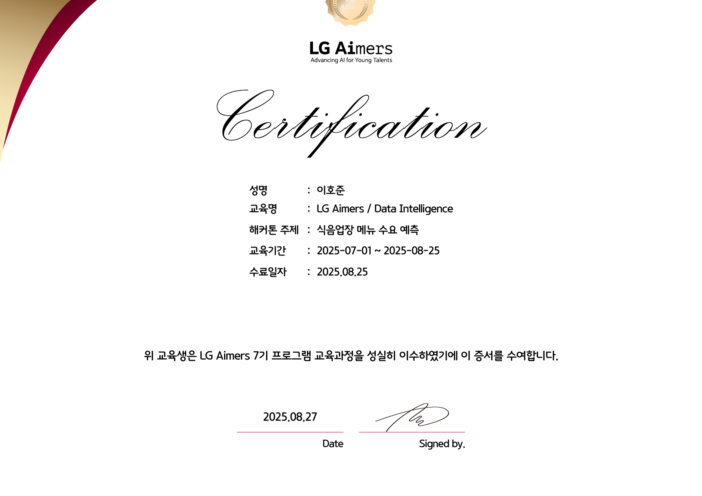

  

  
  
  

---

## 👋 About Me

음성 인식(STT)과 음성 합성(TTS)에서 시작해, 지금은 **RAG와 LLM 에이전트**를 만들고 있습니다.

직관이 아닌 정량적 지표를 바탕으로, 실용적이고 통제 가능한 LLM 에이전트를 구축합니다.

| | |
|---|---|
| 🎓 | **숭실대학교 소프트웨어학부** (2020.03 ~ 2026.02) |
| 🚀 | **카카오테크 부트캠프 AI 실무개발 4기** (2026.05 ~ ) |
| 🎖️ | 해병대 1263기 병장 만기전역 (2020.10 ~ 2022.04) |
| 🔬 | RAG Architecture · Agent Systems · LLM Fine-tuning · Evaluation |

---

## 🏆 AI 성능 개선 대회 — 최우수상

> **카카오 약관 QA 시스템** · 13팀 ·  **88.889 / 100**
> 검색 MRR `1.0000` · 키팩트 F1 `0.6721` · LLM 판정 `97.450`
> 공개 10문항 검색 recall **12/12** · precision **12/12**

카카오 약관 4종에서 질문에 해당하는 조항을 찾아 **답변과 근거 조항을 함께** 반환하는 RAG입니다.
Google Colab T4 한 대, 외부 API 없이 동작합니다. → [저장소 보기](https://github.com/HojuneLee0106/Performance_Improvement_Contest)

---

## 💼 Experience

### AItheNutrigene · AI/ML 인턴 2024.12 ~ 2025.02

**SK Shieldus STT 성능 개선 프로젝트** (약 12주) — `Python` `NVIDIA NeMo` `KenLM`

<picture>
  <source media="(prefers-color-scheme: dark)" srcset="assets/stt-improvement-dark.png">
  
</picture>

N-gram Language Modeling으로 도메인 어휘를 반영하고, Neural Rescoring으로 후보 문장을 다시 정렬해 인식 오류를 줄였습니다.

---

## 🚀 Projects

### 📈 [맴매 · 소상공인 AI 운영 매니저](https://github.com/100-hours-a-week/KTB4-7th-AI) `진행 중`

카페·소규모 음식점 점주가 올린 POS 매출로 **다음 달 일별 매출을 예측**하고, 그 지표를 근거로 운영 솔루션을 제안하는 서비스.
6인 팀 프로젝트(2026.08 ~ ) · **AI 2인 — AI 서버 전체(매출 예측 · LLM 솔루션/인사이트 · 챗봇 에이전트 · GPU 서빙 검증)를 공동 설계·구현**

**AI 서버 구조 — 계산은 코드가, 생성은 LLM이**

- **LLM에는 원본 거래 대신 백엔드가 산출한 확정 지표만 넣습니다** — 모델이 수치를 만들어낼 여지를 없앴고, 모든 솔루션 카드에 근거 지표(`evidence`)를 붙여 "이 숫자가 어디서 나왔는가"를 추적할 수 있게 했습니다.
- **솔루션 카드 3장과 인사이트를 LLM 1회 호출로 생성합니다** — 카드별 3회 호출 대비 지연·비용이 1/3이고, 한 번에 만들기 때문에 카드 간 조언 중복이 없습니다. 하루 단위로 고정해 같은 날 재진입해도 내용이 바뀌지 않습니다.
- **챗봇은 단일 에이전트(agent ↔ tools)입니다** — 점주 질문은 단발성이라 서브 에이전트로 나누면 LLM 호출만 2~3배로 늘어납니다. 부족한 지표만 BE 조회 툴로 그때그때 가져오고, 답변은 SSE로 스트리밍합니다.
- **계약을 코드로 고정했습니다** — 요청·응답 스키마(Pydantic)를 단일 진실 원천으로 두고, 라우터는 얇게·로직은 서비스 계층에만 두는 규칙으로 4개 엔드포인트를 분리했습니다.

**매출 예측 모델 선정 — 같은 조건에서 5개 비교**

| 모델 | MAPE D+30 | MAE | 학습+추론 |
| --- | --- | --- | --- |
| Seasonal Naive (베이스라인) | 17.51 | 193,568 | 2ms |
| **Ridge (α=12, 피처 7종) — 선정** | **13.62** | **164,157** | **14ms** |
| Prophet | 13.90 | 173,654 | 356ms |
| TimesFM-3 (zero-shot + 공변량) | 14.90 | 172,627 | 329ms (CPU) |
| LightGBM | 18.74 | 209,090 | 20ms |

카페 1곳 176일치(결제 17,125건), rolling origin 65회 · 각 origin에서 이후 30일 예측.
베이스라인 대비 **3.89%p(상대 22%) 개선**.

- **비교 조건부터 맞췄습니다** — 초기 실험은 모델마다 피처 결측 범위가 달라 origin 수가 34~66개로 제각각이었습니다. 결측을 보정해 65개로 통일한 뒤 재평가했습니다.
- **진단 지표보다 반복 검증을 믿었습니다** — `is_weekend`는 VIF 7.51로 중복이 의심됐지만, 넣었을 때 MAPE가 15.26 → 14.03%로 개선돼 유지했습니다. permutation importance가 음수였던 전월 집계 피처도 빼면 성능이 무너져서 남겼습니다.
- **편향까지 봤습니다** — MAPE만으로는 보이지 않던 과소예측(-5.1%)을 찾았고, 전월 대비 증가율 피처를 추가해 -3.4%로 줄였습니다.
- **월 1회 업로드에 맞춘 배치 구조** — 예측 대상 월 내부의 lag를 쓰지 않는 피처 설계로 recursive 오차 누적을 막았습니다(D+1 15.71% → D+30 13.62%, 오히려 개선).
- **앙상블은 미채택** — Ridge+Prophet이 -0.41%p였지만, 동기 호출 구조에서 추론 25배 증가를 정당화하지 못했습니다.
- **데이터가 쌓이면 바뀔 지점까지 측정했습니다** — TimesFM-3 LoRA 파인튜닝에서 학습 83일 → 144일일 때 MAPE가 16.06 → 13.13%로 내려갔습니다. 1년치가 쌓이면 재평가할 조건으로 기록했습니다.

**LLM 서빙 — Claude API vs 로컬 vLLM GPU 서빙**

솔루션 카드·챗봇을 자체 GPU로 돌릴 수 있는지, 오픈소스 LLM 9종을 **vLLM + L4 24GB**에서 실서비스와 같은 엔진 조건으로 측정했습니다.
속도보다 **품질 게이트(숫자정합 · JSON 준수 · 도구 선택)를 먼저** 통과해야 후보가 됩니다.

| 모델 | 숫자정합 | JSON | 툴선택 | 생성 1건 | 결과 |
| --- | --- | --- | --- | --- | --- |
| Claude Sonnet 4.5 (기준선) | 5/5 | 5/5 | 6/6 | 10.3s | 기준 |
| **Qwen3-14B AWQ (thinking off)** | **10/10** | **10/10** | **6/6** | **11.2s** | **1순위** |
| Qwen2.5-14B AWQ | 10/10 | 10/10 | 6/6 | 14.2~15.0s | 백업 |
| Qwen3-14B (thinking on) | 8/10 | 8/10 | 0/6 | 26.4s | 탈락 |
| 한국어 특화 3종 (A.X · EXAONE · Kanana) | 0~1/10 | 1~10/10 | 6/6 | 15~24s | 탈락 |

- **한국어 특화 모델은 3종 모두 숫자 환각으로 탈락했습니다** — JSON 형식은 지키면서 근거 지표(`evidence.value`)를 입력에 없는 숫자로 바꿔 쓰는 패턴이 공통으로 나타났습니다.
- **thinking 모드는 구조화 출력에 맞지 않았습니다** — 추론 서술에 토큰을 소진해 도구 이름이 나오기 전에 응답이 잘렸습니다(툴선택 0/6).
- **L4 24GB의 실질 상한은 14B AWQ입니다** — HyperCLOVA X 14B(BF16 28GB)는 OOM, Qwen2.5-32B AWQ는 KV 캐시 부족으로 올라가지 않았습니다.
- **품질은 동급이지만 v1은 Claude API를 씁니다** — 예상 트래픽(월 1천~5천 건)에서는 GPU 상시 가동이 API보다 19~94배 비싸고(월 71만원 vs 1~4만원), 실측 GPU 가동률이 2%였습니다. 손익분기(월 9.4만 건) 근접, 데이터 외부 전송 이슈, API 요금 변경 중 하나가 생기면 바로 전환할 수 있도록 대안을 검증해 뒀습니다.

`FastAPI` `Pydantic` `LangGraph` `Anthropic Claude` `SSE` `scikit-learn` `pandas` `TimesFM` `PEFT/LoRA` `vLLM` `AWQ` · [설계 문서(Wiki)](https://github.com/100-hours-a-week/KTB4-7th-wiki/wiki)

### 🛂 [Settle Agent · 외국인 정착 지원 에이전트](https://github.com/settle-AGENT/settle-agent)

국내 체류 외국인의 금융·행정 정착을 돕는 AI 에이전트.
신분증을 찍어 올리면 OCR 로 프로필을 만들고, 체류자격 룰로 **지금 무엇을 할 수 있고 무엇이 막혀 있는지**를
계산해 과제로 보여줍니다. 법령·안내매뉴얼을 근거로 답하고, 통합신청서 같은 서식을 채워 PDF 로 만듭니다.
팀 프로젝트 · **AI 담당 (`ai/`)** · 지원 자격 **D-2(유학) · E-9(비전문취업)**

 

**그래프 — 경로는 코드에 고정, 자유는 조회 안에서만**

노드와 엣지가 `graph.py` 에 고정되어 있고 **승인 게이트를 우회하는 엣지가 없습니다.**
L2 액션은 모델이 어떻게 동작하든 사용자 승인 없이 실행될 수 없고,
L3(금융실명법 제3조 등 대행 불가)는 실행 경로 자체가 없습니다.

**모델이 자율적으로 도는 곳은 Researcher 한 곳뿐입니다.** 거기서는 모델이 조회 도구를
스스로 고르고 최대 6회까지 반복 호출합니다 — 자유는 "무엇을 몇 번 찾아볼지"까지고,
**"가능한가"는 룰이 정합니다.** 도구 목록에 실행 도구를 넣지 않은 게 안전 장치입니다.

도구는 판단 재료가 아니라 **결론**을 돌려줍니다 — 체류자격 매트릭스 원문을 넘기면
모델이 자격을 추론해버리므로, planner 가 이미 낸 결론(`status`, `blocked_by`)만 전달합니다.
모델은 틀린 말을 할 수는 있어도 **틀린 행동은 하지 못하게** 만드는 게 설계의 목표였습니다.

 

**검색 · 서류**

| | |
|---|---|
| **Corpus** | 법령 조문 `397` (출입국관리법·시행령·금융실명법·특정금융정보법) + 법무부 외국인체류 안내매뉴얼 `1,212` |
| **Retrieval** | BM25(한글 음절 바이그램) + pgvector 코사인 → RRF · 사용자 자격 일치 문서 ×1.6, 타 자격 전용 ×0.45 |
| **다국어** | 영문 질의를 문서에 실제로 쓰인 낱말로 먼저 치환 (`part-time job` → `시간제취업 체류자격 외 활동`) |
| **서류** | **LLM 추론 없음** — `mappings/*.yaml` 결정적 매핑 → Jinja2 → WeasyPrint PDF · OCR 신뢰도 0.95 미만은 '확인요망' 표시 |

 

**Stack**

| | |
|---|---|
| `ai/` | Python 3.12 · FastAPI · LangGraph · CLOVA OCR · pgvector |
| `backend/` | Java 21 · Spring Boot 3 · JPA · JWT · S3 presigned |
| `frontend/` | React 18 · Vite 5 |
| `infra` | Docker Compose · Caddy · GitHub Actions → GHCR → SSM → EC2 · CodeRabbit PR 리뷰 |

검색 평가는 정답 문서를 하나로 특정하기 어려워서, **무너지면 반드시 깨지는 것 하나만** 봅니다 —
내 자격 문서가 남의 자격 문서에 밀리지 않는가.

 

**v2 — 자격 확장 · 근거 최신성 · 개인정보**

- **E-9 추가 — 코드가 아니라 룰 선언으로 확장했습니다.** 뼈대는 D-2와 같고, 자격별 차이는 매트릭스에만 적습니다.
  소속 기관이 통합신청서의 학교 칸인지 근무처 칸인지(`org_kind`), 증빙 서류(재학증명서 → 근로계약서·사업자등록증)가 그 차이입니다.
  E-9의 시간제취업은 **"가능"으로 잘못 안내하지 않도록 닫아 뒀습니다** — 근무처 변경은 별개 절차인데 아직 정의하지 않았기 때문입니다.
- **E-9 등록증에 맞춰 OCR을 고쳤습니다.** 뒷면의 근무처를 회사 형태 표기(`㈜`, `주식회사` 등)를 기준으로 추출하고,
  인도네시아처럼 이름이 한 낱말인 송출국 사용자는 신뢰도를 낮춰 화면에서 확인받게 했습니다.
- **"선행조건 충족"과 "과제 완료"를 분리했습니다.** 하나의 집합이 둘을 겸해서,
  이미 등록증이 있는 사람도 계좌를 열려면 필요 없는 통합신청서부터 만들어야 했습니다. 현실에서 끝난 일은 뒤 과제를 열어 주되, 그 과제 자체를 완료로 치지는 않습니다.
- **근거 자료가 낡았는지 기계가 매일 확인합니다.** 법령·매뉴얼·서식의 판과 마지막 확인일을 `sources.yaml` 한 곳에 선언하고,
  실제 파일과 어긋나거나 확인한 지 오래된 자료가 있으면 GitHub Actions가 이슈를 열고, 통과하면 닫습니다.
  감지는 기계가, 반영은 사람이 합니다. 배포된 컨테이너가 어느 판으로 답하는지는 `/health`로 노출합니다.
- **신분증 원문이 남지 않게 했습니다.** OCR 원문이 에이전트 state에 들어가 체크포인트에 평문으로 쌓이던 것을 끊고, 이미 쌓인 것은 정리 스크립트로 지웠습니다.
  세션은 마지막 활동 기준 30일 뒤 삭제하고, 에러 응답에서 예외 메시지를 빼 프로필 값이 클라이언트로 새지 않게 했습니다.

 

### ⚖️ [생활법률 RAG 챗봇 "법대로"](https://github.com/HojuneLee0106/online_law)

법조문 · 대법원 판례 · 생활법령을 근거로 답하는 법률 Q&A 어시스턴트.
답변의 조문 번호와 사건번호를 **원문에서 그대로 가져와** 인용합니다.

 

**아키텍처**

한 턴에 세 도구를 **병렬 호출**하므로 도구를 3개 쓰는 질문도 LLM 왕복은 2회뿐입니다.

 

**무엇을 재고 어떻게 정했나**

<picture>
  <source media="(prefers-color-scheme: dark)" srcset="assets/rag-quality-dark.png">
  
</picture>

| | |
|---|---|
| **Stack** | LangGraph · Chroma · FastAPI(SSE) · Docker → GHCR → EC2 |
| **Eval** | `answer_quality 0.912` · `citation_grounding 0.984` · `tool_recall 1.000` |
| **설계** | LangSmith로 단일/멀티 에이전트 3개 구조를 비교한 뒤 single 채택 |

검색 인프라를 총동원한 개선이 **+0.031**이었던 반면, 모델 교체 한 번이 **+0.128**로 4배 컸습니다.
반대로 1회 실행 측정으로는 개선과 노이즈를 구분할 수 없다는 것도 같이 배웠습니다.

 

### 🔊 AI Docent Studio 캡스톤디자인 · 2025.09 ~ 2025.12

사용자 맞춤형 **TTS 모델(VITS)** 제작. 도슨트 음성을 개인화하는 프로젝트로, **RISE 사업 체결**로 이어졌습니다.

`VITS` `PyTorch` `Speech Synthesis`

 

### 🏋️ AI 헬스 자세 교정 어플리케이션 캡스톤디자인 · 2025.03 ~ 2025.06

**QLoRA** 기법으로 파인튜닝한 헬스케어 맞춤 챗봇. 운동 도메인에 특화된 응답을 생성하도록 경량 학습했습니다.

`QLoRA` `PEFT` `FastAPI`

 

---

## 🛠 Tech Stack

**AI / ML**

  
  
  
  
  
  
  

**LLM / RAG**

  
  
  
  
  
  

**Backend / Infra**

  
  
  
  
  
  

**Collaboration**

  
  
  
  
  
  

---

## 📊 GitHub Stats

  

---

## 🏅 Activities & Certification

### 🎓 LG Aimers 7기 · Data Intelligence 2025.07.01 ~ 2025.08.25 수료

수료증 보기

 

 

### 🏈 숭실대학교 크루세이더스 (중앙 미식축구부)

- 회장 2023.10 ~ 2024.11
- 디펜스 캡틴 2022.06 ~ 2025.12
- 2025 서울 대학 미식축구 최강자전 **디비전 2 준우승**

 

### 📜 Certification

- OPIc **IH** 2026.03
- 정보처리기사 2026.09 취득
- ADSP 2026.08 취득
---
